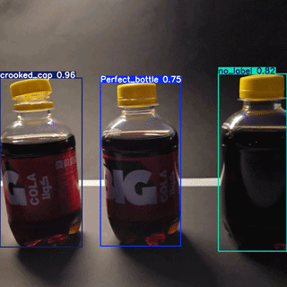
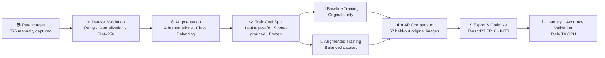
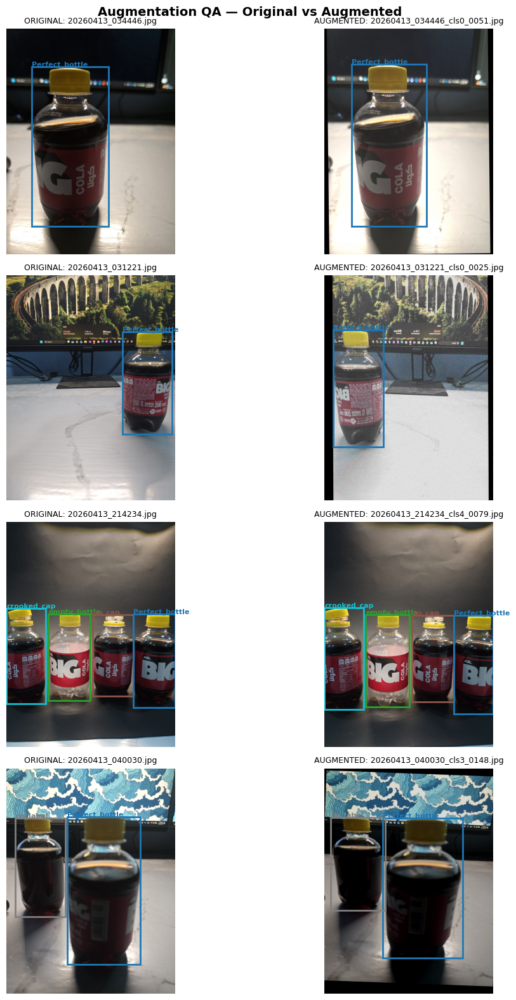
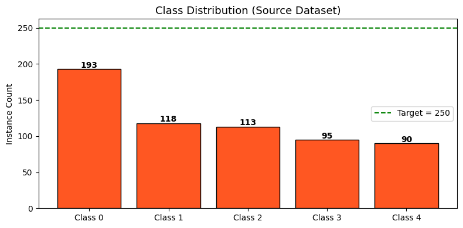
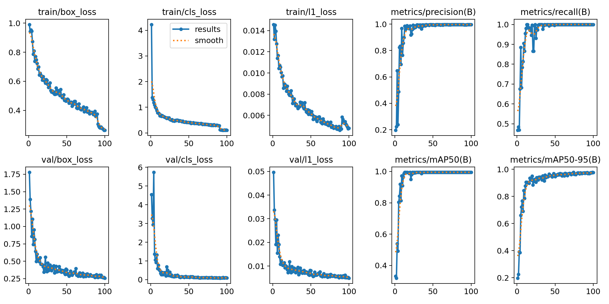
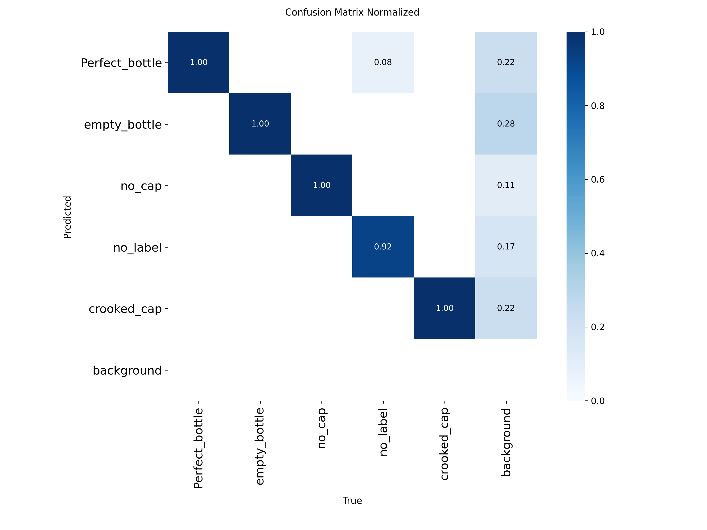

# 🍶 Big Cola — Industrial Bottle Quality Control Pipeline

An **end-to-end computer vision pipeline** that detects and classifies **Big Cola bottle conditions** on a **simulated factory conveyor belt** using a custom-built dataset and **YOLO26n (Ultralytics)**.  
Built from scratch: physical data collection, manual annotation, augmentation engineering, a frozen and fingerprinted evaluation split, controlled training experiments, and TensorRT FP16/INT8 inference optimization with accuracy re-validated after every export.


---



*Demo recorded with an earlier training run of this project. All metrics in this README come from the October 2026 clean rerun.*

---

## 📋 Table of Contents

1. [🚀 Why This Project](#why-this-project)
2. [🏗️ Pipeline Architecture](#pipeline-architecture)
3. [📁 Project Structure](#project-structure)
4. [📊 Key Features](#key-features)
5. [🔧 How It Works](#how-it-works)
6. [📦 Dataset](#dataset)
7. [📈 Results](#results)
8. [⚡ Optimization & Deployment Benchmarks](#optimization-benchmarks)
9. [🛠️ Requirements](#requirements)
10. [▶️ Quick Start](#quick-start)
11. [👤 Author](#author)

---

## 🚀 Why This Project <a name="why-this-project"></a>

Most student machine learning projects start with a downloaded dataset.  
This one started with a **trip to the supermarket**.

Building an industrial-style quality-control system from zero means solving problems that tutorials never mention: inconsistent label formats, coordinate corruption during augmentation, stale output files silently poisoning training runs, a validation set that quietly changes between sessions, and the challenge of simulating a factory environment with no factory access. It also means asking what happens *after* training finishes: this project pushes the trained model through TensorRT FP16 and INT8 exports and measures the cost of getting there.

This project demonstrates how to:
- **Design and capture** a controlled industrial dataset from physical products
- **Engineer a robust pipeline** with validation gates, dataset fingerprinting, and reproducible experiments
- **Apply and validate** image augmentation without corrupting bounding box coordinates
- **Measure the real impact** of augmentation: baseline vs. augmented, scored on the same frozen validation images
- **Optimize for deployment** on a cloud GPU via TensorRT FP16 and INT8, with accuracy re-validated after each export, not just latency
- **Audit your own results:** the October 2026 rerun exists because two flaws were found in the original pipeline (Bugs 8 and 9 in the debrief) and fixed

Eight pipeline bugs and one benchmarking lesson were found, diagnosed, and fixed during development. All nine entries are documented in [`docs/engineering_debrief.md`](./docs/engineering_debrief.md).

---

## 🏗️ Pipeline Architecture <a name="pipeline-architecture"></a>



The pipeline is structured across **sequential phases**, each with its own validation layer before proceeding to the next, ending in a deployment-optimization stage that validates both speed *and* accuracy on every exported format.

---

## 📁 Project Structure <a name="project-structure"></a>

```
bigcola-bottles-quality-control/
│
├── README.md                        ← You are here
├── Big_Cola_QualCtrl.ipynb          ← Executed clean rerun (Google Colab), outputs included
├── big_cola.yaml                    ← YOLO dataset configuration (Colab paths)
├── requirements.txt                 ← Pinned dependencies
├── model_card.json                  ← Model metadata, metrics, hashes
├── LICENSE                          ← MIT
├── .gitignore
│
├── models/
│   └── best_bigcola.pt              ← Final-epoch weights (last.pt) of the augmented run
│   (TensorRT .engine files are intentionally not committed — see note below)
│
├── splits/                          ← Frozen train/val manifests + SHA-256 fingerprints
│
├── results/
│   ├── rerun_results.json           ← All metrics, latencies, versions, hashes
│   └── rerun_summary.csv            ← Summary table (accuracy + latency per format)
│
├── docs/
│   ├── engineering_debrief.md       ← 9-entry post-mortem (8 pipeline bugs + 1 benchmarking lesson)
│   └── dataset_card.md              ← Dataset construction, classes, capture methodology
│
└── assets/
    ├── gif_inference.gif            ← Conveyor belt inference demo (earlier training run)
    ├── class_distribution.png       ← Class balance before and after augmentation
    ├── training_curves.png          ← Ultralytics loss and mAP curves, augmented run
    ├── confusion_matrix_normalized.png ← Confusion matrix, augmented run
    └── augmentation_samples.png     ← Original vs. augmented examples
```

> **Note on the `.engine` files:** TensorRT engines are compiled for a specific GPU architecture and TensorRT version, so an engine built on Colab's T4 isn't portable to other hardware. They are excluded via `.gitignore`; the exact export commands and environment versions are documented below so results are reproducible rather than just replayable.

---

## 📊 Key Features <a name="key-features"></a>

| Feature | Description |
|:---|:---|
| **End-to-End Ownership** 🔨 | Dataset designed, captured, and annotated entirely by the author — no pre-existing data used |
| **Industrial Simulation** 🏭 | Black paper background and tripod-controlled capture to replicate conveyor belt conditions |
| **Validation Gates** 🛡️ | Hard assertions on label parity, coordinate bounds, and class ID format before any training proceeds |
| **Dataset Fingerprinting** 🔑 | SHA-256 of the raw labels plus frozen, hashed train/val manifests in `splits/` |
| **Class Balancing** ⚖️ | Albumentations pipeline targets a minimum of 250 instances per class |
| **Controlled Experiments** 🔬 | Baseline vs. augmented on the same frozen validation images: +2.4 points mAP50-95 |
| **GPU Optimization** ⚡ | TensorRT FP16 vs INT8 on a Tesla T4, one shared timing loop, model-only and end-to-end latency |
| **Post-Quantization Validation** ✅ | Accuracy (mAP50-95) re-measured after every TensorRT export (FP16 and INT8), not assumed unchanged |
| **9-Entry Post-Mortem** 📝 | All pipeline and optimization failures documented with root cause, diagnosis, and fix |

---

## 🔧 How It Works <a name="how-it-works"></a>

### Phase 1 — Dataset Validation
Before a single image is augmented or trained on, the pipeline verifies:
- Every image has a matching label file (parity check using set arithmetic on file stems)
- Every label file has valid YOLO coordinates within `[0, 1]`
- Class IDs are normalized from float strings (`4.0` → `4`) to prevent downstream parse failures
- A SHA-256 fingerprint is computed from all label files and stored for traceability

A hard assertion gate stops execution if any check fails.

### Phase 2 — Augmentation
Albumentations transforms are applied with YOLO-format bounding box passthrough: coordinates are never manually converted before passing to the library. Transform parameters are kept conservative to prevent coordinate clamping artifacts (Bug 4), and the noise transform is configured through the Albumentations 2.x API with its effective parameters checked (Bug 9). Augmentation is seeded.



### Phase 3 — Train / Val Split
The split is grouped by **source scene**: all augmented variants of an image always go to the same partition as their source, preventing leakage between train and validation sets. The split is then **frozen**: manifests and their SHA-256 fingerprints are stored in [`splits/`](./splits/), and the exact dataset is archived, so every model and every export is scored on identical images.

### Phase 4 — Training Experiments
Two training runs share one fixed recipe (YOLO26n, AdamW, 100 epochs, 640×640, batch 16, seed 42, no early stopping):
- **Baseline:** original training images only: establishes the performance floor
- **Augmented:** same scenes plus class-balancing augmentation: measures augmentation impact

Both are scored on the same 57 held-out original images, using final-epoch weights.

### Phase 5 — Optimization & Export
The augmented model's final-epoch weights are exported to **TensorRT FP16** and **TensorRT INT8** (calibrated on 500 training images) and benchmarked on a Tesla T4 with one shared timing loop. Every format is re-scored for accuracy on the same 57 held-out original images, so quantization is measured as a tradeoff, not assumed away. See [Optimization & Deployment Benchmarks](#optimization-benchmarks) below.

---

## 📦 Dataset <a name="dataset"></a>

The dataset was built entirely from scratch using physical Big Cola bottles and a controlled capture setup.

| Property | Value |
|:---|:---|
| **Total images** | 376 |
| **Classes** | 5 |
| **Annotation format** | YOLO (normalized) |
| **Augmentation target** | 250+ instances per class |
| **Train / val (after augmentation)** | 907 images (319 scenes) / 160 images (57 scenes) |
| **Environment simulation** | Black paper background + tripod |

### Classes

| ID | Name | Description |
|:---|:---|:---|
| 0 | `Perfect_bottle` | No defects — correct cap, label, and fill |
| 1 | `empty_bottle` | No liquid content |
| 2 | `no_cap` | Cap missing |
| 3 | `no_label` | Label missing |
| 4 | `crooked_cap` | Cap misaligned or improperly sealed |



📥 **Full annotated dataset available on Kaggle:** https://www.kaggle.com/datasets/youssefeldemerdashh/big-cola-bottles-dataset-for-yolo-quality-control

For full dataset construction details, see [`docs/dataset_card.md`](./docs/dataset_card.md).

---

## 📈 Results <a name="results"></a>

**Evaluation protocol.** The train/val split is grouped by source scene, so augmented copies of a scene never cross the split. All models are scored on the **57 held-out original (non-augmented) validation images** (96 boxes). The split is frozen: each manifest in [`splits/`](./splits/) carries a SHA-256 fingerprint (hash of its sorted entries) in `splits/hashes.json`. Reported weights are the **final epoch** (`last.pt`): no checkpoint was selected using the evaluation images. Hyperparameters were fixed before training and are identical for both runs.

| Run | Training data | mAP50 | mAP50-95 | Precision | Recall |
|:---|:---|:---:|:---:|:---:|:---:|
| Baseline | 319 original training images | 0.995 | 0.953 | 0.996 | 1.000 |
| Augmented | Same 319 scenes + class-balancing augmentation | 0.995 | **0.977** | 0.997 | 1.000 |

Augmentation adds **+2.4 points mAP50-95** on the same validation images, and every class improves:

| Class | Val boxes | Baseline | Augmented | Δ (points) |
|:---|:---:|:---:|:---:|:---:|
| Perfect_bottle | 29 | 0.958 | 0.963 | +0.5 |
| empty_bottle | 20 | 0.926 | 0.968 | +4.2 |
| no_cap | 19 | 0.937 | 0.971 | +3.5 |
| no_label | 13 | 0.967 | 0.988 | +2.1 |
| crooked_cap | 15 | 0.979 | 0.995 | +1.6 |

mAP50 and recall are saturated for both runs (every bottle is found), so the gain is in **box tightness at strict IoU thresholds**, which only mAP50-95 shows.

> **Caveats:** 57 images and a single seed. Per-class differences of a point or two are within noise; the overall direction (all five classes up) is the meaningful signal. The augmented run was interrupted by a Colab disconnect and resumed from `last.pt` at epoch 96 of 100; hyperparameters are unchanged and the reported weights are the final-epoch `last.pt`.




*Plots are Ultralytics' own output from the augmented run, validated on the same 57 original images. The confusion matrix is drawn from Ultralytics' `best.pt` checkpoint, which differs from the final-epoch `last.pt` scored above; the headline numbers come from the separate 57-image scoring of `last.pt`.*

Weights: `models/best_bigcola.pt` (SHA-256 `f18eb0f27f2b67f5490be8a11d6002834ed810cf07294ebac1b00150ec2f0d8d`). Full metrics, versions and hashes: [`results/rerun_results.json`](./results/rerun_results.json). Model metadata: [`model_card.json`](./model_card.json).

---

## ⚡ Optimization & Deployment Benchmarks <a name="optimization-benchmarks"></a>

The augmented model (**YOLO26n**, ~2.4M parameters, 640×640) was exported to TensorRT FP16 and INT8 and benchmarked on a **Tesla T4** with one shared timing loop: batch 1, 50 warm-up calls discarded, 500 timed calls, CUDA-synchronized.

- **Model-only:** a 640×640 tensor already on the GPU, timed through the Ultralytics predictor (includes its pre/post-processing; excludes JPEG decode, resize and host-to-GPU copy).
- **End-to-end:** from a JPEG file path (12 MP image decode + resize + inference + post-processing).

| Format | mAP50-95 | Model-only mean | p50 | p99 | End-to-end p50 | p99 |
|:---|:---:|:---:|:---:|:---:|:---:|:---:|
| PyTorch FP32 | 0.977 | 11.98 ms | 11.35 ms | 20.18 ms | 126.2 ms | 206.7 ms |
| **TensorRT FP16** | **0.978** | **3.96 ms** | **3.85 ms** | **4.91 ms** | 118.0 ms | 189.8 ms |
| TensorRT INT8 | 0.961 | 4.29 ms | 4.32 ms | 6.00 ms | 117.1 ms | 207.0 ms |

**FP16 is the deployment choice:** mean latency −67% (11.98 → 3.96 ms) and p99 −76% (20.18 → 4.91 ms), with **no measurable accuracy change** (+0.13 points, within noise on 57 images). The FP16 export is mixed precision (Ultralytics converts the ONNX graph with ModelOpt AutoCast), not a uniform FP16 cast.

**INT8 was evaluated and rejected:** −1.6 points mAP50-95 overall (worst classes: crooked_cap −3.7, no_label −3.4, no_cap −2.2; calibrated on 500 *training* images), and it is not faster than FP16 at batch 1. A likely reason is that a 2.4M-parameter model is overhead-bound rather than compute-bound on a T4 at batch 1 (a hypothesis; not profiled).

**Where the time actually goes:** end-to-end, inference is ~3% of the latency (≈4 ms of ≈118–126 ms); decoding and resizing 12 MP JPEGs dominates. On a real line, the next gains come from capturing at a lower resolution or decoding on the GPU, not from a faster model.

**Reproducibility:**
- Exports: `model.export(format='engine', quantize=16)` and `model.export(format='engine', quantize=8, data=<calibration yaml>)`
- Environment: Ultralytics 8.4.175, PyTorch 2.11.0+cu130, CUDA 13.0, TensorRT 11.4.0.106, Albumentations 2.0.8, Tesla T4 (Google Colab)
- `.engine` files are not committed: they are tied to the GPU architecture and TensorRT version.
- Raw numbers: [`results/rerun_summary.csv`](./results/rerun_summary.csv)

---

## 🛠️ Requirements <a name="requirements"></a>

- Python 3.10+
- Ultralytics (YOLO26n)
- Albumentations 2.x
- OpenCV (`cv2`)
- TensorRT (GPU export/benchmarking only — not needed to run the `.pt` weights)
- NumPy
- Matplotlib
- PyYAML
- tqdm

Install all dependencies:
```bash
pip install -r requirements.txt
```

> **Platform note:** This project was developed and trained on **Google Colab** with data stored on **Google Drive**. The notebook is self-contained: mount your Drive, update the path variables in its Config cell, and run the cells in order. TensorRT export and benchmarking require a CUDA-capable GPU (a Colab T4 was used).

---

## ▶️ Quick Start <a name="quick-start"></a>

### 1. Clone the Repository
```bash
git clone https://github.com/Demerdashh/bigcola-bottles-quality-control.git
cd bigcola-bottles-quality-control
```

### 2. Install Dependencies
```bash
pip install -r requirements.txt
```

### 3. Open in Google Colab
Upload `Big_Cola_QualCtrl.ipynb` to Google Colab, mount your Drive, and set the path variables in the notebook's Config cell.

### 4. Run the Pipeline
Execute the cells in order. Each phase validates before proceeding:
1. **Pre-flight** — installs and checks every TensorRT dependency before any training. It stops on purpose; restart the session and run all again.
2. **Dataset validation** — parity checks, label normalization, SHA-256 fingerprint
3. **Augmentation** — generates the balanced dataset (a guard cell stops it from overwriting a dataset already frozen on Drive)
4. **Train / val split and freeze** — scene-grouped split, manifests and hashes
5. **Training and evaluation** — baseline run → augmented run → both scored on the 57 original validation images
6. **Export and benchmark** — TensorRT FP16 and INT8, accuracy and latency per format, results written to `rerun_results.json` and `rerun_summary.csv`

> The notebook in this repo is the executed run, so a few cells show errors on purpose or because they were re-run after a restart. A note at the top of the notebook explains each one.
>
> After a Colab disconnect: mount Drive first and check the mount, then run the setup, Config, Restore and Build-YAMLs cells. Interrupted training resumes from `last.pt` on Drive.

---

## 👤 Author <a name="author"></a>

Built by **Youssef El Demerdash**

- [LinkedIn](https://www.linkedin.com/in/youssef-eldemerdash-754674378/)
- [GitHub](https://github.com/Demerdashh)

---

*For pipeline failure analysis and lessons learned, see [`docs/engineering_debrief.md`](./docs/engineering_debrief.md)*  
*For dataset construction details, see [`docs/dataset_card.md`](./docs/dataset_card.md)*
